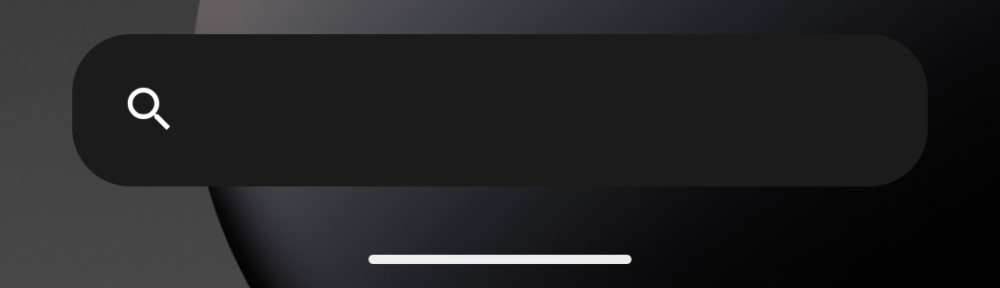
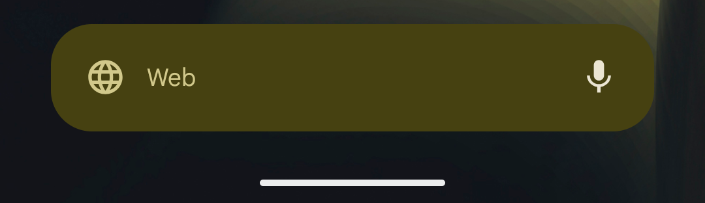

# Superdock

Configurable home screen search widget for Android

<p align="center">
  
  
</p>

## Features

- Search widget with up to two configurable buttons on each side and one for the center field
- Buttons can be bound to any activity on the device
- Custom icon and color picking (with Material You support)
- Search engine override via `selected_search_engine` secure setting using Shizuku

## Android

You can download Superdock from the [Releases](https://github.com/vzpyr/superdock/releases).

## Build

You need the Android SDK and JDK.

```bash
./gradlew :app:assembleDebug
```

The APK will afterwards land in `app/build/outputs/apk/debug/`.

## Setup

Grant Shizuku permission and switch your active search engine to Superdock.

## License

[MIT](LICENSE)
